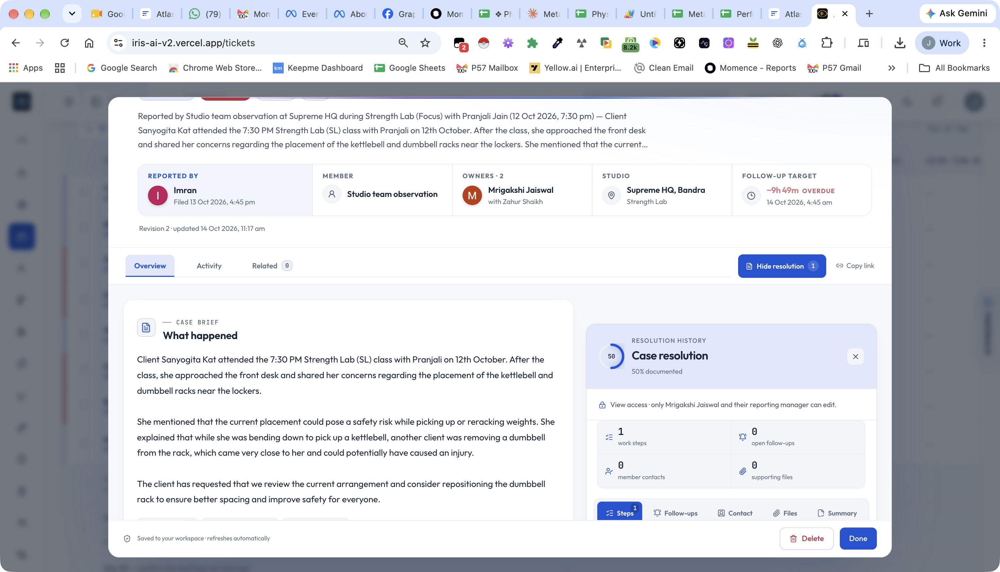
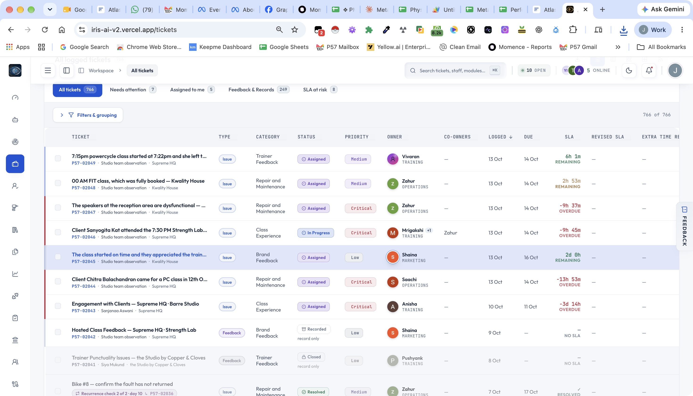

# IRIS product audit — 14 October 2026

Read-only review of the signed-in production ticket workspace and directory at iris-ai-v2.vercel.app, plus the current local source. Deployment/source commit parity was not established. No tickets, settings, messages, or accounts were changed. ROI rankings are qualitative estimates; no usage telemetry or financial baseline was available.

## Captured flow and evidence limits

1. Ticket P57-02046 detail and embedded resolution: usable, with important identity and classification ambiguities. Screenshot starts partway down the existing scroll position; it does not prove initial modal layout.
2. All tickets directory: usable, but visually wide and difficult to scan. Screenshot captures the current scrolled state rather than the page top.
3. Overview: accessibility tree inspected; screenshot unavailable because the active Chrome tab changed during capture. No visual design verdict for this screen.
4. Intake, analytics, background jobs, lookups, and authorization: source reviewed; live flows not exercised. Remaining routes, mobile, dark mode, keyboard navigation, persistence, provider delivery, and authorization across accounts were not verified.

## Overall judgment

The app already has structured intake, linked Momence session context, ownership and reporting-manager rules, record-only feedback, duplicate suggestions, recurrence checks, delivery retries, and shared metrics. Improve the consistency and actionability of these features before expanding the module count.

## Accuracy findings

### A1. Member identity can contradict the member voice — high priority

Observed: P57-02046 describes a named community member reporting a near miss, while the member field and directory label read “Studio team observation.” Reported details show a client was involved. This makes member history and follow-up unreliable even when the narrative is informative.

Source: src/lib/intake/plan.ts falls back to this placeholder when no member is linked or typed. Existing intake gates already attempt to require member identification in certain paths; the live record does not establish whether it predates those rules or used a different path.

Recommendation: represent reporter, affected member, and feedback origin as separate fields. Use “member not identified” with a reason instead of putting an observation type in a person field. Require either a verified member link or an explicit unresolved-identity choice when logging member-reported feedback. Add a review queue for contradictory records. Never silently identify someone from narrative text.

### A2. Missing sentiment becomes neutral — high priority

Source: ticket-contract.ts defaults sentiment to neutral; intake/plan.ts also supplies neutral when no recognized answer exists. “Not reported” and neutral are different facts.

Recommendation: add not_shared / unknown, distinguish member-stated sentiment from an AI suggestion, and retain source evidence for any suggestion. Only compute sentiment percentages over explicitly known values and show coverage.

### A3. SLA compliance has competing definitions — high priority

Source: overview-canvas.ts calculates healthy open tickets / all open tickets and labels the result “SLA compliance.” metrics.ts defines compliance as (SLA-tracked tickets − breached tickets) / SLA-tracked tickets, including overdue open and late resolved work. The overview calculation also treats due-soon work as unhealthy.

Recommendation: use the shared metric contract for compliance everywhere. If the current overview measure is useful, name it “Open work outside SLA risk.” Every metric should expose its numerator, denominator, exclusions, period, scope, and refresh time. Separate original-target compliance from revised-target compliance.

### A4. Category and routing deserve a consistency check — high priority

Observed: the safety case is categorized “Overcrowding in Class,” while the narrative concerns studio tool placement; its session snapshot shows 9 attendees against capacity 10. Below-capacity attendance does not disprove local crowding, so this is a review signal, not proof of a wrong category. Training leads the case with Operations as co-owner.

Recommendation: suggest “Studio tool placement / near miss” for review, explain routing, and let the reporter confirm. Distinguish attendance capacity, usable floor space, unsafe placement, and member perception. Capture disagreements to improve the classifier.

### A5. Documentation percentage can imply more progress than exists — medium priority

Source: resolution-panel.ts gives full step credit if any step exists and full follow-up credit when no follow-ups exist. These are documentation signals, not verified completion.

Recommendation: replace the percentage with a category-specific checklist: action recorded, evidence added where required, member contacted where appropriate, outcome verified, follow-up completed or explicitly not needed. Keep documentation completeness separate from case resolution.

### A6. Lookup failures can look like empty searches — high priority

Source: multi-select.ts clears live results on non-abort errors without preserving a visible error state in that catch path.

Recommendation: show distinct searching, no matches, provider unavailable, and expired connection states. Offer retry and a clearly labeled manual fallback. Track failed lookups and the resulting unlinked-member rate.

### A7. Automation timing depends partly on app traffic — high priority

Source: vercel.json schedules a daily outbox job. sweeps.ts also runs SLA and delivery work opportunistically after requests. Quiet periods can therefore delay reminders and retries; a failure was not observed in this audit.

Recommendation: use a regular worker independent of browser activity, monitor last successful sweep and oldest queued item, and alert on stalled delivery. Verify with a no-traffic test. Vercel currently documents daily-only Hobby cron execution and imprecise invocation within the scheduled hour: https://vercel.com/docs/cron-jobs/usage-and-pricing . The source comment claiming a two-job limit is stale.

## Intuitive workflow and styling

- Directory: default to Ticket, Studio/member, Owner, Status, Priority, and Next action/due. Move co-owners, revised SLA, extension, escalation history, and resolution duration into optional columns or detail. Retain the existing advanced views for users who need them.
- Titles: generate concise factual labels from verified fields. The live directory includes narrative openings and a malformed “00 AM FIT class” label. A better reviewed safety-case title would be “Near miss beside studio tool racks — Strength Lab.” Preserve the full narrative separately.
- Navigation: the captured collapsed sidebar contains many icons; the accessibility tree exposes sixteen destinations. Use labeled Work, Intelligence, and Administration groups. Make Log member voice, My work, and Studio queue the obvious daily destinations. Gate developer utilities by role.
- Ticket detail: lead with reported concern, requested outcome, lead owner, and next action. Keep member voice and internal observations visibly separate. Collapse repeated reported details. Move Delete into a secondary menu; its presence alongside Done increases accidental-action risk, though deletion safeguards were not exercised.
- Resolution: retain the integrated workspace and explicit view/edit explanation. Add “waiting on whom,” next commitment, and clear handover responsibilities for co-owners.
- Style: preserve white surfaces, navy text, and blue selection. Reduce avatar gradients, decorative shadows, outlined badges, uppercase microcopy, and competing tinted panels. Use color mainly for priority, status, focus, and selected state.
- Accessibility: muted historical rows look harder to read. Measure text contrast rather than infer a failure from screenshots. Test focus order, table sorting, combobox arrows/Escape, modal focus return, zoom, mobile reflow, and dark mode. WCAG minimum contrast guidance: https://www.w3.org/WAI/WCAG22/Understanding/contrast-minimum.html .
- Intake: one global context block for reporter, studio, member, session, incident time, and channel; only category-specific fields afterward. Keep existing conditional logic, required-only mode, session linking, and read-back confirmation. Measure actual completion time before expanding forms.

## Features ranked by likely ROI

| Rank | Improvement | Relative effort | Expected benefit | Measure |
|---|---|---|---|---|
| 1 | Intake consistency checks and record-quality queue | Medium | Better identity, classification, sentiment, and follow-up accuracy | Unlinked member reports; correction rate |
| 2 | Role-specific next-action queue | Medium | Faster daily work and fewer missed commitments | Time to first action; overdue age; handover misses |
| 3 | Reliable scheduled delivery and automation health | Medium | Timely reminders even when nobody is browsing | Dispatch lag; stalled jobs; delivery success |
| 4 | Unified metrics with evidence drilldowns | Small–medium | More trustworthy operational decisions | Cross-screen reconciliation; unexplained discrepancies |
| 5 | Resolution playbooks and outcome verification | Medium | More consistent closure and fewer repeat faults | Reopen rate; verified closure; recurrence |
| 6 | Compact directory and labeled navigation | Small–medium | Faster scanning and easier onboarding | Time to locate a ticket; navigation errors |
| 7 | Evidence-linked triage assistant | Medium–large | Less classification and drafting effort | Suggestion acceptance; corrections; unsupported claims |
| 8 | Member service-recovery timeline | Medium–large | Better context across repeated touchpoints | Follow-up completion; repeat complaints |
| 9 | Asset recurrence and downtime analysis | Medium | Better repair and replacement decisions | Downtime; repeat faults; repair cost where recorded |
| 10 | Partnership experience conversion tracking | Medium–large | Connect member voice to acquisition outcomes | Consented lead → consultation → paid package conversion |

## Smarter behavior

Build a triage assistant that proposes category, severity, routing, and a concise brief with reasons and supporting fields. Use deterministic safety and access rules; ask a clarifying question when evidence is ambiguous. The reviewer approves consequential changes. Maintain a held-out evaluation set containing real, appropriately protected examples, ambiguous cases, unknown identities, missing sentiment, record-only feedback, and safety incidents. Measure category accuracy, routing accuracy, safety recall, and unsupported-claim rate before release.

Extend existing duplicate scoring with fault-specific reasons and a member/asset/session timeline. A matching asset is not by itself proof of the same fault. Separate repeated reports of an open incident from a new fault after verified closure. Retrieve approved similar resolutions with ticket references and outcome evidence; do not reuse unverified historic actions as authoritative playbooks.

For retention, expose member-stated cancellation intent and observed service history. Do not present inferred churn probability or saved revenue without a validated model and linked outcomes. For partnership experiences, retain source, consent, follow-up preference, and a defined attribution window.

## Suggested delivery order

First: unify SLA semantics, introduce unknown sentiment, fix lookup error states, add identity contradiction checks, and repair title generation. Next: compact the directory, add next-action queues, verify scheduled delivery, and strengthen closure evidence. Then pilot the triage assistant and member/asset timelines. Expand partnership ROI reporting once identity and conversion linkage are trustworthy.

Baseline two weeks of logging time, field corrections, first-action latency, overdue age, lookup failures, delivery lag, and reopen rates. Compare after rollout by studio and ticket category, with sample sizes shown. Estimate financial ROI as staff time saved plus evidenced operational savings minus build and running costs; do not claim prevented churn as earned revenue.
