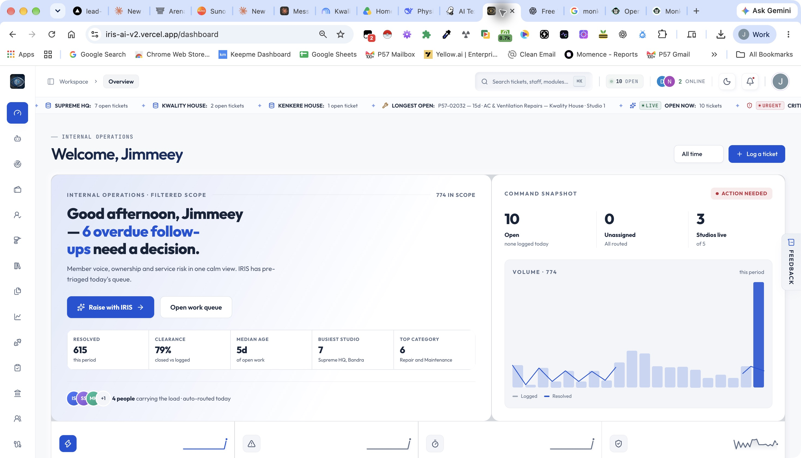
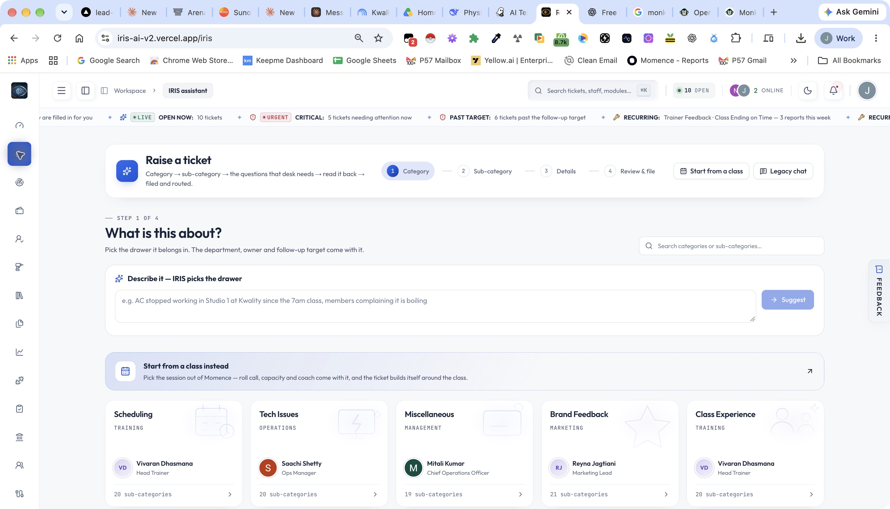
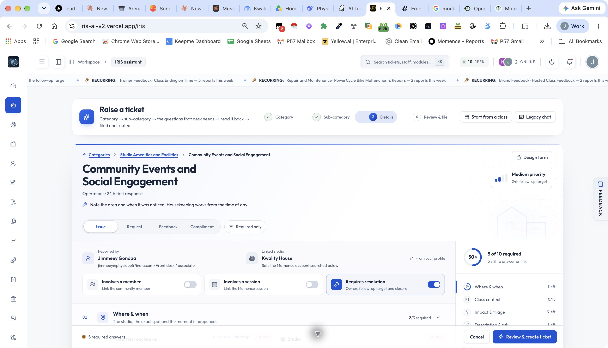
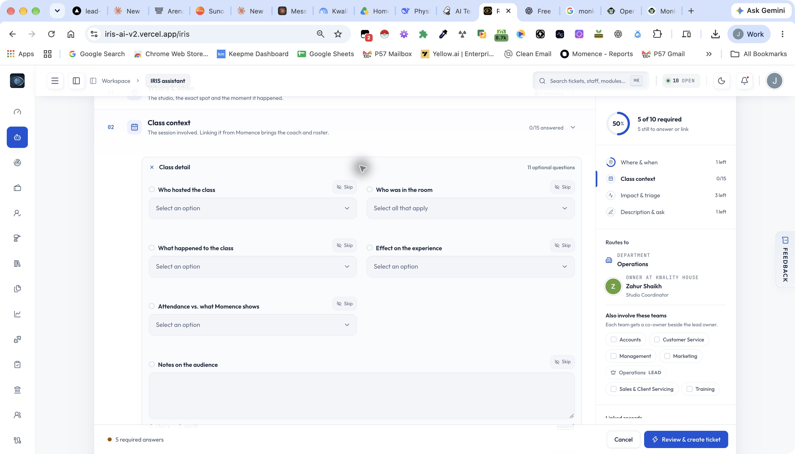
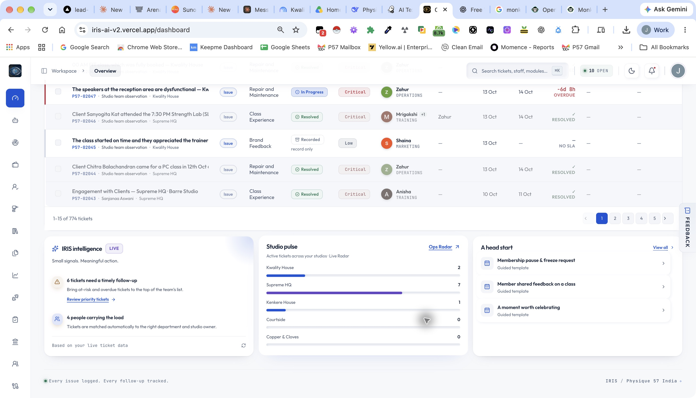
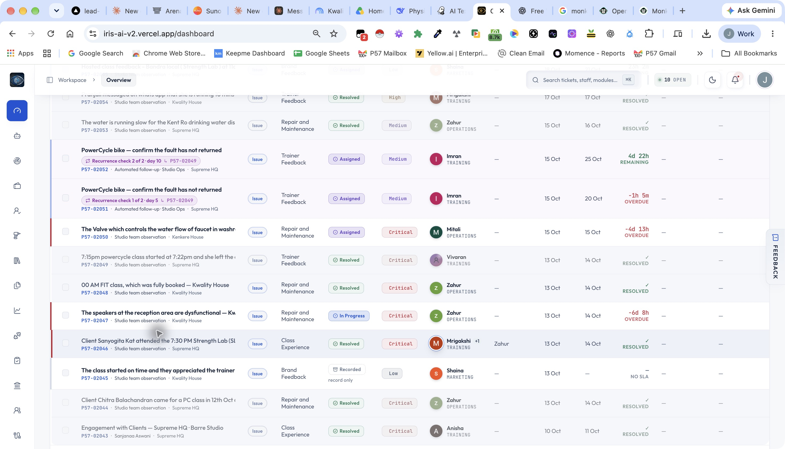
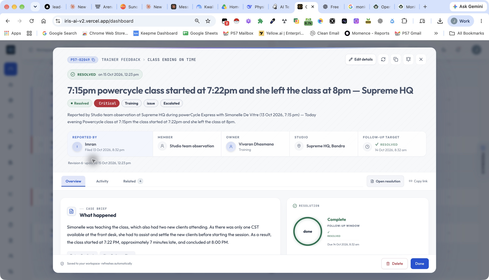

# IRIS app audit — 20 October 2026

The reported problems are confirmed. The app needs a shared behavior contract and a simpler content system. Editing individual labels will leave inconsistent form, routing, priority and ticket behavior in place.

This review combines the signed-in production interface at iris-ai-v2.vercel.app with current local source at commit `b953256`. The supplied `ai-powered-support-ticket-hub (4)` folder has no source; source inspection used the adjacent `ai-powered-support-ticket-hub-4` checkout. Production deployment-to-commit parity was not established. Local findings are identified separately from live observations. No tickets, settings, assignments or member records were intentionally changed. Ordinary page reads can trigger the app's existing background sweeps.

## Evidence and coverage

1. **Overview — needs correction.** Captured the overview, operational copy and queue. Screenshot 01.
2. **Category selection — needs correction.** Captured category-first intake, metaphorical copy and owner promises before location is selected. Screenshot 02.
3. **Community Events and Social Engagement form — poor relevance.** Opened the form without submitting. It displays housekeeping guidance, time-of-day requirements and class enrichment despite the session switch being off. Screenshots 03–04.
4. **Ticket list — inconsistent semantics.** Inspected a Recorded entry still labeled Issue, and generated bike checks linked to a punctuality report. Screenshots 05–06.
5. **Ticket detail — misleading SLA presentation.** Opened P57-02049. Its description concerns a late session start; it has two bike-check children. It resolved on 15 October after its 14 October target, yet shows a green resolved follow-up indicator. Screenshot 07.
6. **All generated default plans — structural scan complete.** Inspected 299 local default taxonomy variants, not every production override or form interaction. Machine-readable field inventory is in `generated-form-inventory.json`.
7. **Server behavior — source review and pure probes.** Reviewed creation, preview, routing, co-owners, updates, status transitions, resolution and automatic checks. Production mutation behavior, concurrency and notifications were not exercised.

The local inventory contains 11,055 field occurrences across 299 forms: 23–62 fields per form, averaging 36.97. 147 variants exceed 35 fields; 66 exceed four textareas. Counts include optional and conditional fields. These are default source counts, not counts of forms enabled in production. The existing form check separately scans 296 raw source plans, averaging 21.2 fields visible before any answer; the scopes differ.

## Priority findings

P1 means a correction should precede expanding usage or automation. P2 means material usability or consistency work. Evidence is marked Live, Source or Probe.

### 1. P1 — A session name is sufficient to create false equipment work

**Live:** P57-02049 is a Trainer Feedback / Class Ending on Time report. Its description explains a seven-minute late start while the instructor assisted newcomers. P57-02051 and P57-02052 nevertheless ask the reporter to confirm a PowerCycle bike fault has not returned. They retain Trainer Feedback and Training while describing Studio Ops repair work. Screenshot 06 and the original ticket in screenshot 07.

**Source:** `src/lib/tickets.ts:579` accepts any ticket with PowerCycle in classFormat, irrespective of a documented fault. `maybeCreateRecurrenceChecks` at line 618 then creates equipment checks and copies the original category/department.

**Correction:** Create checks only from a confirmed repair classification with an identified equipment type and explicit eligibility. A class format must never establish a fault. Separate verification tasks from reported issues, carry the actual asset and repair reference, and apply an explicit verification owner rule. Review existing generated checks for false positives before correcting any saved records.

### 2. P1 — Positive or negated statements are routed to repairs

**Probe:** “Member complimented the wireless microphone and the instructor” becomes Audio, Mic & Headphone Malfunction. “Member praised the cleanliness of the studio” becomes Housekeeping & Cleaning Issues. “The microphone was not broken. Member reported rude behaviour” becomes Audio, Mic & Headphone Malfunction.

**Source:** `src/lib/equipment-routing.ts:29` matches equipment/housekeeping keywords without sufficient fault or negation handling. Wireless microphones/headsets and housekeeping terms can trigger repair routing without a failure. `makeDraft` applies this before validating taxonomy and routing.

**Correction:** Preserve the reported subject and entry type. Require an affirmative current fault before automatic repair classification. Show a proposed classification change for review when prose conflicts with the selected category. Keep reported facts distinct from inferred classification.

### 3. P1 — Preview and saved ticket use different action and priority rules

**Source:** `src/components/intake/intake-flow.tsx:281` treats compliments and positive feedback as record-only. `src/lib/tickets.ts:167` treats all feedback and assessments as record-only when no client is detected, even when resolutionRequired is true. Conversely, linking a client forces actionable work and at least High priority, including praise. The intake priority badge does not include that server-side client rule. The composer has another record-only calculation based on its switch.

**Impact:** A user can ask for resolution and get a record, or see no follow-up target and receive a High-priority actionable ticket. Merely linking the person can change the operational meaning.

**Correction:** Model entry type, action required, urgency and member linkage separately. A compliment can have a named member without becoming urgent work. Negative feedback can need action. Use the same server-evaluated policy result for preview and creation and preserve the explicit action decision unless a clearly explained safety rule overrides it.

### 4. P1 — Saved routing settings are not authoritative

**Source:** `departmentForTicket` in `src/lib/tickets.ts:75` hardcodes Training/Operations before reading category and subcategory settings. It also applies broad operational keyword rules and refuses configured Training for categories outside its fixed set. `resolveRouting` at line 83 computes an override but chooses a named city owner before category/studio owner overrides; only a subcategory owner suppresses the named-city choice.

**Impact:** Settings can appear successfully saved while having no effect. This is a precedence defect, not simply a missing rule.

**Correction:** Publish one explicit precedence order: required safety routing, validated subcategory override, studio/category override, category default, eligible staff selection, accountable department queue. Display when a mandatory rule prevents a setting and why. Store the rule ID/version and assignment reason with the ticket.

### 5. P1 — Co-owner selection and later updates bypass the lead-owner policy

**Source:** `coOwnersFor` in `src/lib/tickets.ts:115` repeats selection logic, takes the first named city match rather than the least-loaded training owner, and does not apply the sales round-robin policy. Manual PATCH assignment in `src/app/api/tickets/[id]/route.ts:212` accepts an active owner and changes the ticket's department to that person's department without category/studio eligibility checks. Changing studio does not rerun routing. Automated checks construct drafts directly.

**Correction:** Use one resolver for lead owners, contributing teams, manual reassignment validation and automation. Keep “responsible department” separate from an owner's home department. Define whether studio changes trigger reassignment, and require an explicit reason for a permitted routing exception.

### 6. P1 — Member and session enrichment can survive a cleared or changed selection

**Source:** Intake effects at `intake-flow.tsx:200` and line 232 return early for a missing ID without clearing existing memberDetail/classDetail. They preserve the previous record during replacement loading or failure. Review passes memberDetail, its contact/context and classSnapshot into `toTicketInput` at line 352. The mapper prefers those cached values.

**Impact:** Clearing a member/session or selecting another whose lookup fails can leave the previous record's details available to the next ticket payload. This is a source-confirmed risk; a production submission was not performed.

**Correction:** Bind enriched data to the selected ID and studio/account. Clear dependent data on unlink; invalidate previous enrichment immediately on replacement. Include it only when its ID matches the current selection and its lookup has completed successfully. Preserve manually entered facts with explicit provenance.

### 7. P1 — Status rules do not define a complete lifecycle

**Source:** `assertStatusTransition` in `src/lib/tickets.ts:536` checks record-only use, resolution evidence and reopen configuration, but has no full transition matrix. PATCH accepts any enum status. Server authorization for general nonterminal status changes is not aligned with the UI statement that only owners/managers may change status. Terminal-to-terminal writes skip the owner/resolution guard because it applies only when current status is nonterminal.

**Correction:** Define allowed transitions and actor permissions centrally. Apply them to detail, board, Radar and API calls. Reject meaningless changes, recorded-to-active transitions without changing the action pathway, and unauthorized terminal edits. Include co-owners in accurate permission messages.

### 8. P1 — Repeated resolution writes can change historical resolution time

**Source:** `statusTimestamps` at `tickets.ts:550` assigns now for resolved → resolved when closedAt is null. `resolveTicket` also emits ticket.resolved on a terminal write without requiring an actual transition.

**Impact:** An otherwise harmless repeated save can alter measured time to resolution and emit duplicate downstream events. No live mutation was performed.

**Correction:** Treat same-status requests as no-ops for timestamps and transition events. Store first resolution and each reopen/resolution cycle separately if needed. Preserve first resolution through close and repeated saves.

### 9. P1 — Resolution commits before its required automation succeeds

**Source:** `resolveTicket` commits the ticket transaction, then calls `maybeCreateRecurrenceChecks`. A failure afterward can return an error although the ticket is resolved. A retry sees a terminal ticket and skips check creation, allowing missed checks. Deterministic child keys already provide useful duplicate protection.

**Correction:** Record a durable automation job in the resolution transaction and retry it independently. Return the successful ticket save plus automation state. Make both event and child-task processing idempotent.

### 10. P1 — One SLA clock means several different things

**Live:** The event form calls the same period “24 h first response” and “24h follow-up target.” P57-02049 resolved after its target but the detail panel presents a green completed follow-up window. Screenshot 07.

**Source:** `metrics.ts` evaluates breaches using resolvedAt against slaDueAt. `plan.ts:slaLabelFor` describes first response; `slaHoursFor` clamps targets to 12–72 hours. Priority changes recompute the due date from original creation and can overwrite an extended target while extension metadata remains. The intake badge reads priority defaults rather than a subcategory override.

**Correction:** Define separate first response, next update and resolution targets, or consistently name a single chosen target. Preserve original target and extensions as distinct facts. Show “Resolved late” when appropriate. Safety guidance must call for immediate action independently of any administrative SLA; review the 12-hour minimum against that policy.

### 11. P2 — Forms are assembled from broad question banks

**Live:** Community Events and Social Engagement includes a 15-question class block while Involves a session is off. It asks who hosted a class, attendance discrepancies, membership compatibility and rebooking intent. The header instructs staff to log an area for housekeeping. Screenshots 03–04.

**Source:** `plan.ts:345` uses regex relevance rules over inherited banks. Published form overrides bypass that filtering (`planFields`, line 497). Unresolved dependencies become always visible (`dependencyOf`, line 232).

**Correction:** Give each form an explicit purpose and approved field IDs. Attach shared modules only under defined conditions. Validate dependency references at publication instead of falling back to always visible. Migrate published snapshots as well as generated defaults; fixing only plan-data or the generator will leave old live forms unchanged.

### 12. P2 — The app does not reliably distinguish common facts from category-specific facts

**Live:** The community-event form asks an exact occurrence time and a required time-of-day band. The original ticket displays both session instructor and a separate “Trainer concerned” with a different person; their relationship is unexplained. The field inventory shows many repeated occurrences across forms.

**Correction:** Define shared fields once, render them in one Global details section, and reuse their values. Derive day part from time and instructor/format from a linked session. A distinct instructor under review is valid only when explicitly labeled and different from session instructor. Category sections should contain only questions that change the action or decision.

### 13. P2 — Brand language and colloquial metaphors obscure operational meaning

**Live:** “Pick the drawer,” “IRIS picks the drawer,” “the questions that desk needs,” “one calm view,” “carrying the load” and “read it back → filed and routed” make simple actions harder to understand. “Notes on membership compatibility” is undefined. “HOW THEY FELT” is displayed even for a staff observation.

**Source:** `pickers.tsx:24`, `describe-box.tsx:45`, `nuance.ts:66`, `plan.ts:711` and shared dashboard/detail copy.

**Correction:** Use direct professional language. Keep Community member, Studio session and Instructor where useful. Avoid replacing every ordinary word with marketing language. Label facts as “Member reported…” only when they were actually communicated by a member; label team observations separately.

### 14. P2 — Forms solicit inferred intent and narrative converts it into fact

**Live/source:** “Will they come back?” and churn-risk fields invite staff predictions. `composeWriteup` generates “The member came across negative, churn risk high.” A pure probe reproduced that sentence without a member quote.

**Correction:** Ask “Did the member state an intention to return?” with stated intent / undecided / not discussed options, and a supporting quote where relevant. Ask about cancellation only when the member raised it. Put objective staff observations in a separate optional field. Do not infer retention or sentiment from an entry merely existing.

### 15. P2 — Defaults turn unknown facts into apparently reported facts

**Source/live:** `seedData` at `plan.ts:632` defaults reporter type to Front desk / associate, preference to WhatsApp and occurrence time to now. The live account is displayed as front desk regardless of the user's actual role. The API defaults preferredContact to Email. These can be operational conveniences, but are not evidence of member preference or incident time.

**Correction:** Auto-record the authenticated author and logging timestamp. Keep occurrence time unconfirmed until supplied or derived from a linked session. Contact preference should default to Not provided and remain separate from contact channels available in CRM. Derive the staff role from the profile.

### 16. P2 — “Required” can be bypassed and is not enforced consistently on the server

**Probe:** Applying Skip to all required fields produces no missing-field errors in the generated-plan validator. Some ticket-contract fields still block creation, so this is not a claim that an empty ticket can be saved.

**Source:** `missingFields` at `plan.ts:543` excludes skipped required fields. Ticket creation validates the ticket contract and some template requirements, but does not apply the generated/published plan's full visibility and required-field contract. Template validation checks required fields without evaluating their visibility.

**Correction:** Distinguish essential, conditional and optional fields. Essential routing/safety fields must remain enforceable. Allow “Unknown” or “Not provided” with a reason where appropriate. Run one visibility-aware server validator for every form path using its published schema version.

### 17. P2 — The data model requires a member even for internal work

**Live:** “Studio team observation” appears as the Member and Ticket contact on a staff-only ticket. The summary says “Reported by Studio team observation” although the actual author is Imran.

**Source:** `ticket-contract.ts:5` requires memberName; `plan.ts:781` substitutes a placeholder. Routing then uses placeholder-name heuristics to determine whether a client is involved.

**Correction:** Make member linkage optional. Store reporter, subject type and member separately. Render “Internal observation” as the subject type, not a fictitious member. Author attribution should always use the actual author when known.

### 18. P2 — Entry type defaults and action pathway create conflicting records

**Live:** P57-02045 is praise/feedback marked Recorded, record only, no SLA, yet Type is Issue. Hosted feedback P57-02055 is also labeled Issue. A saved historical type is not proof that its renderer alone is wrong.

**Source:** `openSub` in `intake-flow.tsx:119` resets every selected form to kind issue; it does not infer a suitable default from the form's purpose.

**Correction:** Give forms explicit defaults and permitted types, separate type from action requirement, and explain both in review. Provide a reviewed migration for contradictory existing records rather than silently changing history.

### 19. P2 — Assignment eligibility relies on names and location heuristics

**Source/probe:** City ownership is a set of regexes over display names. `cityOf` returns Mumbai for any nonempty location that does not mention Bengaluru/Bangalore; the probe maps Unknown location and Delhi to Mumbai. Shared legacy studio IDs cause Courtside/Copper to have no unique studio IDs. The fallback can pick staff outside the intended studio pool. Read-then-select rota/load logic has no reservation across concurrent submissions.

**Correction:** Use stable staff IDs, explicit studio memberships, configured city coverage and availability. Unknown studio/city should be unresolved rather than silently Mumbai. Make rotation selection atomic with assignment. Preserve a department queue fallback with an accountable manager when nobody is eligible.

### 20. P2 — Ticket closure does not establish completion of follow-up work

**Source:** Closure requires a nonempty actionTaken but does not check outstanding resolution follow-ups, steps or member confirmation. A pending task may therefore outlive a resolved parent without an explicit open-work decision.

**Correction:** Define a completion policy per ticket purpose: repair verification, member request outcome, internal request delivery, or record-only acknowledgement. Before closure, show pending work and either complete it or transfer it to an owned task with a due date and reason. Do not require member confirmation where no member is involved.

### 21. P2 — Resolution write-up has weaker concurrency protection than ticket changes

**Source:** `src/app/api/tickets/[id]/resolution/route.ts` upserts the write-up without a version, unlike the ticket PATCH. Two owners/managers can overwrite each other's resolution text. This is a source risk, not a tested concurrent production loss.

**Correction:** Version the resolution record and return a conflict with the latest content. Keep an audit history of substantive changes, especially after resolution.

### 22. P2 — Dashboard statements overstate what the data establishes

**Live:** “auto-routed today” appears beside an all-time view even while zero tickets were logged today. “SLA compliance: 97%” has the subtitle “All tracked tickets within target,” which reads as 100% compliance. “Pre-triaged today's queue” does not explain the rule or time window.

**Correction:** Use “4 current owners,” “97% met the target” and an explicit reporting window. Claims about automatic routing today must count assignment events in that window. Label overdue, due soon, resolved late and current open work separately.

### 23. P2 — Form volume and duplicate surfaces make global changes fragile

**Source:** The generated plan, published overrides, template composer, legacy chat and imported forms all have separate inputs or validation paths. Creation shares makeDraft, which is a useful foundation, but field relevance, previews, required rules and manual/automated updates are not fully shared.

**Correction:** Version the shared form/behavior contracts and consume them from each surface. Keep source-specific adapters for imported data while preserving one routing, validation, action and transition policy. Inventory external embeds separately; their question relevance was not audited here.

## Wording changes to apply throughout

| Current wording | Recommended wording |
|---|---|
| Pick the drawer it belongs in | Select a category |
| Describe it — IRIS picks the drawer | Describe the issue to suggest a category |
| The questions that desk needs | Provide the relevant details |
| Review & file | Review and submit |
| Description & ask | Feedback and requested action |
| Impact & triage | Impact and urgency |
| Who this is about | Member details |
| Raised by | Feedback source |
| Reported by [actual signed-in author] | Logged by [author] |
| Studio team observation [in Member field] | Internal observation [subject type] |
| Will they come back? | Member's stated intention to return |
| HOW THEY FELT | Member's expressed sentiment |
| Notes on the host / coach | Feedback about the host or instructor |
| Booking friction members hit | Booking difficulties reported |
| Action pathway | Follow-up required |
| Requires resolution | Action required |
| Follow-up window done | Resolved on [date] — target met / target missed |
| A moment worth celebrating | Record a compliment |
| People carrying the load | Assigned owners |

Apply copy changes to titles, labels, helpers, options, validation errors, generated summaries, notifications, emails, exports and saved-schema migrations. Do not turn unverified staff observations into member statements during rewriting.

## Proposed shared form structure

Define common fields once in a Global details module. Reuse stable IDs across forms rather than creating category-prefixed copies of the same fact. Store schema version with each submission and preserve old labels for historical interpretation.

| Shared fact | Capture policy |
|---|---|
| Logged by and logged at | Automatic; immutable author attribution |
| Studio | Required when location-specific; canonical studio identifier |
| Entry type | Purpose-specific default; user confirms |
| Feedback source/channel | One field for how the member communicated; app submission source automatic and separate |
| Occurrence date/time | Supplied or linked-session derived; Unknown allowed when appropriate |
| Subject type | Member feedback / prospect conversation / internal observation / partner feedback |
| Member/prospect | Conditional; lookup or documented manual identity; no placeholder person |
| Studio session | Conditional; derive instructor, format and time once |
| What was reported | Required factual account; optional verbatim quote separately |
| Reported impact and urgency | Relevant structured answers; retain Not discussed / Unknown |
| Action required | Explicit and independent of sentiment/member linkage |
| Action already taken and response | Conditional; distinguish offered action from completed action |
| Contact preference | Only if stated and follow-up needed; Not provided allowed |
| Evidence | Optional attachment/link references |
| Owner, team, target and routing reason | System-derived preview; controlled override with reason |

After Global details, show only the category's necessary questions. Keep member voice, objective staff observations and internal decisions separate. For member feedback instruments aim for the requested 20–35 available fields and 70–80% structured data; do not force an operational repair or quick log to ask 20 questions merely to meet a template count. Use progressive disclosure and purpose-specific requirements.

Examples: billing needs transaction, charged/expected amounts and requested remedy; it does not need class host or equipment condition. Repair needs asset, symptom, availability, safety impact and immediate action; member details appear only when a member was involved. Hosted partnership feedback needs partner/session, attributable guest comments, stated continuation interest, actual conversions and agreed follow-up; separate commercial team assessment from guest voice.

## Correction order and acceptance criteria

1. **Stabilize behavior.** One policy result for preview/save; explicit fault eligibility; correct enrichment invalidation; state/permission matrix; immutable first-resolution facts; durable automation. Verify no repairs from praise, no bike checks from punctuality, no stale member/session after unlink or replacement failure, and no repeated resolved events for a no-op save.
2. **Make routing authoritative.** Document precedence and eligible pools, use shared lead/co-owner selection, validate manual overrides, handle unknown studios and reserve round-robin atomically. Exercise configured overrides, autoAssign off, absent staff, cross-team work, studio changes, every intake source and simultaneous submissions.
3. **Rebuild form contracts.** One global module plus explicit form-specific modules; migrate published overrides. Require every visible question to have a stated operational purpose. Check visibility for member/session on and off, positive/negative/unknown sentiment, actionable/record-only and all conditional branches.
4. **Rewrite content.** Apply plain professional wording and third-person documentation across surfaces, keeping quoted member words intact. Review a billing complaint, repair, instructor feedback, compliment, hosted partnership and internal request end to end.
5. **Review existing data.** Produce a dry-run list of false verification tasks, type/pathway contradictions, conflicting instructor identity, stale enrichment and routing mismatches. Repair only reviewed records with an audit trail; do not rewrite original member statements.

## Verification and limits

- `npm run check:intake` passed in this run.
- `npm run check:forms` passed in this run, covering 296 raw plans.
- A separate pure-function inventory/probe scanned all 299 default CATEGORY_MAP variants and reproduced the routing, relevance, skip and narrative issues above. Script: `audit-inventory.ts`; results: `generated-form-inventory.json`.
- Existing tests prove useful structural properties but do not establish professional wording, semantic relevance, complete transition authorization, atomic assignment or production end-to-end behavior.
- Production screenshots were captured in the existing signed-in Chrome session. Every saved screenshot was visually inspected before inclusion. No new login, credentials or permission changes were needed.
- No production ticket submissions, reassignment, status changes, deletion, settings publication or notification sends were performed. Role-specific live access, mobile rendering, full keyboard/screen-reader interaction, every production form override, external embeds, provider calls and concurrency remain unverified.
- Visible accessibility risks: repeated generic “Skip” and “expand” control names require contextual labeling; moving banners and the icon-heavy collapsed navigation increase scanning effort; sticky header/footer obscure scrolled content in captures. Contrast, focus trapping, reduced motion and narrow-screen behavior need dedicated checks before any compliance claim.

## Captured screens

### 1. Overview — wording and status claims need correction

### 2. Category selection — terminology and premature owner promises need correction

### 3. Event form — irrelevant housekeeping instructions

### 4. Event form — inherited session questions despite session involvement being off

### 5. Ticket list — recorded praise still typed as Issue

### 6. Ticket list — false bike verification children of a punctuality report

### 7. Original ticket — late-start description and misleading completed SLA presentation

