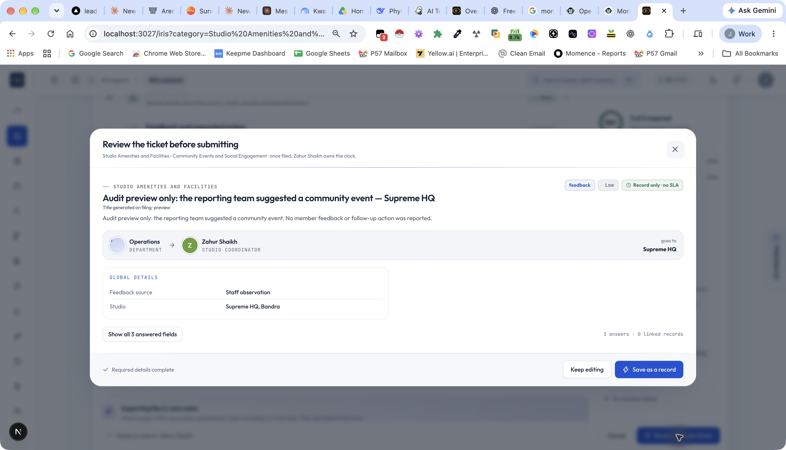

# Audit remediation — 20 October 2026

Implemented the corrections in the local `ai-powered-support-ticket-hub-4` checkout. Application code has not been deployed. Two confirmed false automation tasks were corrected in the connected database; no original reports were deleted or rewritten.

## What changed

| Audit findings | Correction |
|---|---|
| 1–2: false repair classification and recurrence | Fault-based classification excludes praise, negation and historical clauses. Verification requires repair work, never a session format. Record-only closures and verification children cannot spawn repair checks. |
| 3: conflicting action/priority rules | Shared `evaluateTicketPolicy` separates entry type, action required, member identity and urgency. Safety requires action. The review uses a server-calculated draft; the success screen uses the actual saved owner. |
| 4–5, 19: routing precedence and inconsistent owners | Saved form/category overrides are authoritative. Stable directory IDs, explicit studio coverage, shared lead/co-owner selection, an accountable department queue and transactional final assignment replace competing selection rules. Manual exceptions require an administrator's reason. Studio changes reroute. |
| 6: stale linked context | Member/session selections and studio changes invalidate enrichment. Only enrichment matching the selected identity is submitted. The legacy composer also invalidates pending lookups and previous context. |
| 7–8: transitions and timestamps | A shared transition matrix and owner/manager authorization protect changes. Repeated terminal saves preserve resolution time and do not emit another resolution event. Record-only closure does not fabricate a resolution timestamp. |
| 9: lost automation | A durable verification job is recorded in the resolution transaction and retried by background sweeps. Child keys remain idempotent. A failed background job no longer turns a successful resolution into a failed save. |
| 10: SLA meaning | The existing tracked clock is consistently called a resolution target. First-response claims were removed. Late resolutions display as late; extensions survive priority changes. Scheduled verification deadlines are preserved. |
| 11–12, 23: irrelevant fields and inconsistent surfaces | One Global details module, one canonical member field, purpose-based enrichment, removal of duplicate author/time fields, and normalization of older published field snapshots. Generated and published forms use shared kind/visibility validation. |
| 13–15: wording, assumptions and unknowns | Professional labels replace metaphors. Member voice remains separate from staff observation. Speculative churn/rating questions were removed. Missing time, contact preference and sentiment remain unknown. The authenticated author is recorded automatically. |
| 16: skippable required data | Required fields and required lookup gates cannot be skipped. Server validation checks the form version, visibility-aware required answers and lookup gates. Publishing checks dependencies, cycles, regexes, taxonomy and owner/departments. |
| 17–18: artificial member and type | Internal reports no longer need a fictional member. Feedback forms use suitable type/action defaults. Historical record-only entries filed as Issue display as Record without rewriting their original classification. |
| 20–21: incomplete closure and concurrent edits | Resolution blocks while follow-up tasks remain open. Adding follow-up work to a closed ticket requires reopening. Resolution write-ups use an expected revision token and retain prior text in activity history. |
| 22: dashboard claims | Current owners replace “auto-routed today”; SLA descriptions describe the actual denominator. Opaque scrolled headers reduce content showing through navigation. Optional field controls have contextual accessible names. |

The new settings panel exposes city owner pools and explicit staff studio coverage. Existing taxonomy keys and historical member statements are preserved.

## Form inventory

These counts cover all 299 local default taxonomy variants. Optional and conditional fields are included; actual visible questions depend on the submission. Published overrides are normalized at runtime, but their individual content is not included in these default counts.

| Measure | Before | After |
|---|---:|---:|
| Average fields | 36.97 | 27.05 |
| Maximum fields | 62 | 35 |
| Forms exceeding 35 fields | 147 | 0 |
| Forms exceeding four long-text fields | 66 | 0 |

Short forms are allowed to remain short where additional questions add no useful information. See `remediation-form-inventory.json` for the full field inventory. The original audit inventory is preserved separately.

## Historical corrections

The read-only review scanned 774 tickets. It identified two repair verification tasks attached to the punctuality report P57-02049, and 101 record-only entries filed with kind Issue.

Only **P57-02051** and **P57-02052** were changed. Both are now closed, record-only, with their invalid deadlines removed. Their original report text and parent links remain. Each has an explanatory activity, an audit entry and a saved previous state. No resolution timestamp was invented, so these corrections do not count as performed repairs.

The other 101 records were not reclassified: their original intent cannot safely be inferred from type alone. Their current record-only pathway is now displayed accurately. This avoids rewriting historical evidence.

Files: `historical-review.json`, `correction-preview.json`, `correction-applied.json`, `rollback-verified.json`.

The correction command defaults to a dry run and accepts only the two audited tasks after verifying their parent and current state. Rollback was checked in dry-run mode. To restore the saved previous state, if neither task has since changed:

```sh
npx tsx scripts/correct-false-verification-tasks.ts --rollback --apply
```

Rollback refuses to overwrite subsequent edits. The correction sends no email or webhook and deletes no records.

## Verification

- Full `npm test` passed, including 231 unit tests plus the intake, forms, labels, import, dashboard, webhook, email, credentials, access and IRIS checks.
- All 299 default plans pass intake coverage; all 296 raw source plans pass form checks.
- TypeScript and targeted ESLint checks passed. A production build passed.
- The live-directory routing check passed; this verifies directory mappings and pool availability, not a concurrency stress test.
- Signed-in local browser verification reached category-specific form → shared details → studio-dependent owner preview → server-generated review. `/api/tickets?preview=true` returned 200. The event example correctly showed Feedback, Low priority, record-only and no SLA. No preview ticket was submitted.
- The database correction applied to exactly two audited tasks. A subsequent rollback dry run confirmed both snapshots can be restored, subject to their versions remaining unchanged.

### Evidence limits

No deployment, outbound notification test or production status mutation through the new code was performed. The code changes take effect after deployment. Concurrent database race tests, every role-specific browser path, external evaluation embeds and narrow-screen behavior were not exhaustively exercised. The existing environment uses Node 20 despite the package's Node 22 requirement; build/test results describe this local environment.



The captured review predates a final wording adjustment replacing the record-only “owns the clock” sentence with an explicit statement that the record has no resolution deadline.
